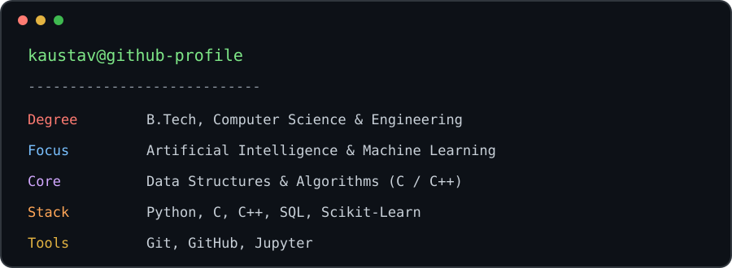
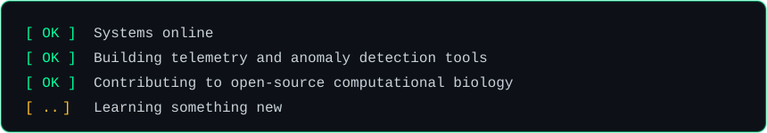
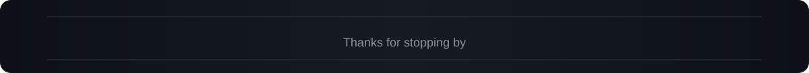

<div align="center">


<a href="https://github.com/Kaustav5505g">
  
</a>

<br/>

<a href="https://linkedin.com/in/kaustav-paul-5505g"></a>
<a href="https://mail.google.com/mail/?view=cm&fs=1&to=paulkaustav0@gmail.com&su=Hello%20Kaustav"></a>
<a href="https://github.com/Kaustav5505g?tab=followers"></a>

</div>


<div align="center">
  
</div>





## `$ list --stack`

<div align="center">

<table>
  <tr>
    <td align="center"><b>Languages</b></td>
    <td align="center"></td>
  </tr>
  <tr>
    <td align="center"><b>Web</b></td>
    <td align="center"></td>
  </tr>
  <tr>
    <td align="center"><b>ML &amp; Data</b></td>
    <td align="center"></td>
  </tr>
  <tr>
    <td align="center"><b>Tools</b></td>
    <td align="center"></td>
  </tr>
</table>

</div>


## `$ execute --projects`

<table>
  <tr>
    <th align="left">Project</th>
    <th align="left">Stack</th>
    <th align="left">Summary</th>
  </tr>
  <tr>
    <td><b><a href="https://github.com/Kaustav5505g/Fraudora">🛡️ Fraudora</a></b></td>
    <td>React 19, FastAPI, Python</td>
    <td>Scam and anomaly detection platform for SMS and WhatsApp messages.</td>
  </tr>
  <tr>
    <td><b><a href="https://github.com/Kaustav5505g/LogSentinel">📡 LogSentinel</a></b></td>
    <td>Flask, Python</td>
    <td>Real-time server telemetry and anomaly detection system with an interactive web dashboard.</td>
  </tr>
  <tr>
    <td><b><a href="https://github.com/biopython/biopython">🧬 Biopython</a></b></td>
    <td>Python, Open Source</td>
    <td>Active contributor to official computational biology routines and tools.</td>
  </tr>
</table>


## `$ git stats --all`

<div align="center">


<br/>


</div>


## `$ contact --open`

<div align="center">

```bash
$ echo "Open to collaboration on ML systems, data pipelines, and open source."
```

<a href="https://linkedin.com/in/kaustav-paul-5505g">LinkedIn</a> •
<a href="mailto:paulkaustav0@gmail.com">paulkaustav0@gmail.com</a> •
<a href="https://github.com/Kaustav5505g">GitHub</a>



</div>
